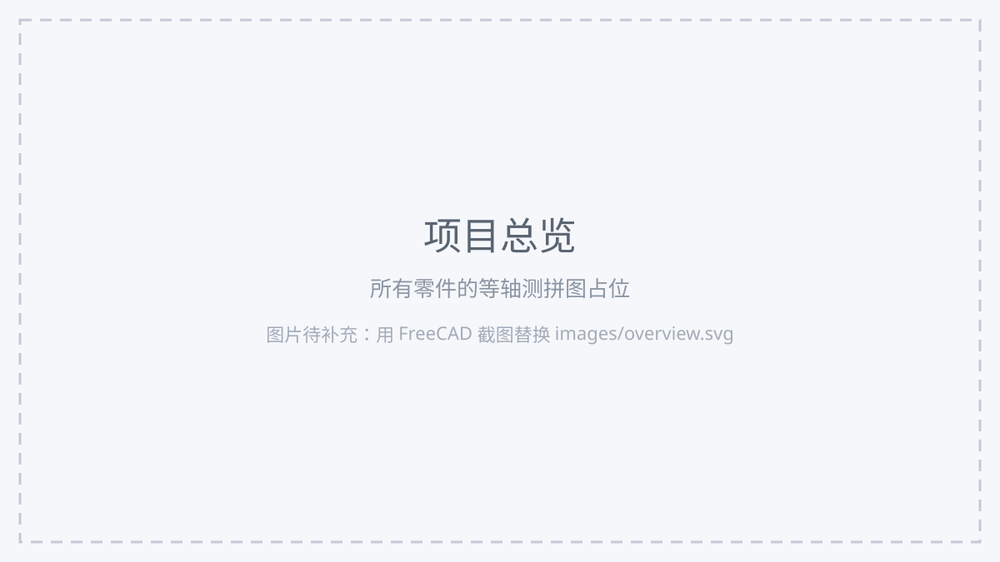

# mechanical-practice-models
> 机械建模练习仓库 · 工具：FreeCAD
## 项目简介
这是大一自学机械建模的练习仓库，记录我使用 FreeCAD 从零学习零件建模的过程。
- 每个零件保留可编辑源文件（`.FCStd`），方便修改尺寸、复用建模特征
- 配套导出 STEP / STL 文件与二维工程图纸，完整练习「建模 → 出图 → 导出」全流程
- 现阶段主攻草图约束、基础实体特征，暂不做复杂曲面
- 仓库附带3D打印BOM清单、机械制图笔记、简易齿轮参数计算Python脚本



## 零件清单
| 序号 | 零件名称 | 模型文件 | 关键特征 | 状态 |
| :--: | --- | --- | --- | :--: |
| 1 | L型固定支架 | `models/l-bracket.FCStd` | 拉伸、打孔、圆角 | 待完成 |
| 2 | 带孔垫片 | `models/washer.FCStd` | 圆形轮廓、孔阵列 | 待完成 |

### 1. L型固定支架

板材连接用基础角件，用来练习双向尺寸约束。
- 建模思路：绘制L形封闭草图，使用拉伸生成实体
- 关键尺寸：臂长、板厚、安装孔中心距
- 练习要点：草图完全约束、孔定位、边缘圆角
- 3D打印建议：PETG，板厚4mm，折角竖直摆放

### 2. 带孔垫片

薄板类零件，练习圆形草图与多孔定位。
- 建模思路：外圆拉伸，草图定位孔位
- 关键尺寸：外径、内孔直径、孔分布圆直径
- 练习要点：对称约束、环形阵列、参数化厚度
- 3D打印建议：PETG，厚度2mm，填充率100%

## 使用软件
| 项目 | 说明 |
| --- | --- |
| 建模软件 | [FreeCAD](https://www.freecad.org/) 1.0 |
| 工作台 | Sketcher草图、Part Design零件、TechDraw工程图 |
| 导出格式 | STEP（`.step`）、STL（`.stl`） |
| 系统 | Windows |
| 脚本 | Python 3.6+，纯标准库，无需额外安装依赖 |

## 仓库目录结构
mechanical-practice-models/
├── models/                     # FreeCAD 源文件 (.FCStd)，可编辑
│   ├── l-bracket.FCStd
│   └── washer.FCStd
├── exports/                    # STEP、STL 导出模型
├── drawings/                   # TechDraw 生成工程图 PDF/SVG
├── images/                     # README 配图（目前是占位图，后续替换为自己截图）
│   ├── overview.svg
│   ├── l-bracket.svg
│   └── washer.svg
├── docs/
│   └── 机械制图学习笔记.md      # 草图、拉伸、打孔、尺寸标注学习笔记
├── bom.md                      # 3D 打印 BOM 物料清单
├── gear_calc.py                # 直齿轮分度圆计算脚本
├── .gitignore                  # 过滤 FreeCAD 自动保存、备份、日志临时文件
├── .dshignore                  # 防止 AI 读取大容量模型文件造成卡顿
└── README.md
> models、exports、drawings文件夹目前为空，建好模型后再放入对应文件。

## 文档与脚本
| 文件 | 内容 |
| --- | --- |
| [bom.md](bom.md) | L支架、垫片3D打印物料清单：材料、厚度、用途备注 |
| [docs/机械制图学习笔记.md](docs/机械制图学习笔记.md) | 入门学习笔记：草图绘制、拉伸、打孔、尺寸标注 |
| [gear_calc.py](gear_calc.py) | 标准直齿轮分度圆直径计算，公式 `d = m × z` |

### 齿轮脚本使用方法
```bash
python gear_calc.py 2 20     # 模数2，齿数20，输出分度圆直径40.00 mm
python gear_calc.py          # 不带参数，进入交互式输入模式
